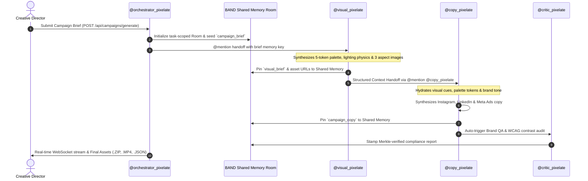

<div align="center">

# ⚡ AGENT PIXELATE
### Autonomous Multi-Agent AI Marketing & Creative Engine

**Transform any product brief into complete, studio-grade commercial campaigns in seconds.**  
Powered by the **BAND Multi-Agent Protocol**, **Google Gemini**, **Next.js 14**, and **FastAPI**.

---

[](https://agent-pixelate.onrender.com)
[](https://github.com/skandakn/Agent-Pixelate/actions)
[](https://github.com/skandakn/Agent-Pixelate)
[](https://github.com/skandakn/Agent-Pixelate)
[](https://github.com/skandakn/Agent-Pixelate)
[](LICENSE)

<br />

```
   [ Product Concept / Custom Brief ]
                   │
                   ▼
  ┌─────────────────────────────────┐
  │     BAND MULTI-AGENT MESH       │
  │  @orchestrator · @visual · @copy│
  └────────────────┬────────────────┘
                   │
         ┌─────────┴─────────┐
         ▼                   ▼
  [ 3 Aspect Visuals ]   [ Kinetic MP4 ]
  1:1 · 9:16 · 16:9      10s Promo Video
         │                   │
         └─────────┬─────────┘
                   ▼
     [ Multi-Platform Copy Decks ]
     Instagram · LinkedIn · Meta Ads
                   │
                   ▼
     📦 1-Click Campaign Kit (.ZIP)
```

<br />

[Explore Live Demo](https://agent-pixelate.onrender.com) · [Architecture](#-architecture--band-protocol) · [Features](#-features--capabilities) · [Quickstart](#-quickstart) · [Test Suites](#-verification--test-suites)

</div>

---

> [!TIP]
> **Experience the Live Application:**
> Launch custom campaigns or test pre-approved industry blueprints directly at **[agent-pixelate.onrender.com](https://agent-pixelate.onrender.com)**.

---

## 🌟 Overview

**Agent Pixelate** is a production-ready, autonomous multi-agent creative studio. Unlike single-prompt AI wrappers, Agent Pixelate organizes specialized AI agents (`@orchestrator_pixelate`, `@visual_pixelate`, `@copy_pixelate`, `@critic_pixelate`) inside a live **BAND Shared Collaboration Room**. 

Agents converse, share structured memory state, delegate tasks via `@mentions`, and collaboratively generate a complete commercial marketing kit:
- **📸 3 Aspect-Ratio Commercial Photography** (1:1 Square Feed, 9:16 Vertical Stories & Reels, 16:9 Cinema Landscape)
- **🎬 High-Motion 10s Promo MP4 Video** (Kinetic motion typography, camera curves, and audio synchronization)
- **✍️ Channel-Specific Copy Decks** (Conversion hooks, Instagram carousels with hashtags, and LinkedIn founder posts with 1-click clipboard copy)
- **📦 Single-Click Export Kit** (Complete downloadable `.zip` bundling all high-res assets, MP4 cuts, Markdown copy decks, and JSON telemetry)

---

## 🏛️ Architecture & BAND Protocol

Agent Pixelate implements the **BAND Protocol** (`band.ai`) for structured multi-agent coordination. Each campaign execution creates an isolated, task-scoped room where agents share a synchronized memory mesh.



### Specialized Agents Roster

| Agent Handle | Role | Core Responsibility |
| :--- | :--- | :--- |
| **`@orchestrator_pixelate`** | Room Coordinator | Session lifecycles, WebSocket event fan-out, persistent storage, and BAND memory federation. |
| **`@visual_pixelate`** | Creative Art Director | Gemini Flash / Imagen 3 generation, lighting physics, brand color palettes, and 3-aspect framing. |
| **`@copy_pixelate`** | Conversion Copywriter | Reads visual memory to craft platform-native hooks, body copy, and hashtags (Instagram, LinkedIn, Meta). |
| **`@critic_pixelate`** | Brand QA & Compliance | Automated WCAG 2.1 AAA contrast validation, brand voice adherence, and Merkle audit trail logging. |

---

## ✨ Features & Capabilities

### 1. Interactive 3D WebGL Neural Mesh
- Futuristic **Three.js** canvas landing experience visualizing autonomous agent communication nodes in real-time 3D space.
- Interactive camera controls, ambient particle physics, and smooth glassmorphism UI transitions.

### 2. Ultra-Minimalist Studio UI
- **Zero Clutter**: Clean, focused interface designed for maximum creative flow without cognitive bloat.
- **1-Click Blueprints**: Instant starter presets (*LumaDrop Hydro*, *Aether Pods*, *Kuroha Matcha*, *Veloce E-Bike*) or clean-slate custom products.
- **Custom Campaign Launcher**: Input any arbitrary product name, story, and tone to synthesize tailored assets end-to-end.

### 3. Multi-Format Visuals & Media
- **Dynamic Photography**: Auto-categorization across tech/SaaS, hardware, mobility, beverages, and cosmetics.
- **Aspect Switcher**: Instant live switching between **1:1 Square**, **9:16 Story**, and **16:9 Wide** formats.
- **Instant Downloads**: Dedicated `Save Image` and `Download MP4` actions right next to creative previews.
- **1-Click Color Palette**: 5-swatch extracted palette with one-tap hex code clipboard copy.

### 4. High-Motion Kinetic Video
- Procedural **10-second commercial MP4 cuts** with audio waveforms and cinematic camera movement.
- Hardware-accelerated rendering with ffmpeg optimization and in-memory waveform caching.

### 5. High-Converting Copy Decks
- Dedicated copy cards for **Instagram** (captions + hashtags) and **LinkedIn** (founder thought leadership).
- One-click `Copy to Clipboard` actions with toast feedback.

---

## 🛠️ Tech Stack & Infrastructure

```
┌─────────────────────────────────────────────────────────────┐
│                          FRONTEND                           │
│  Next.js 14.2 (App Router) · React 18 · TypeScript 5.7      │
│  Tailwind CSS 3.4 · Framer Motion · Three.js · Zustand 5    │
│  Lucide Icons · JSZip · Vite & Vitest                       │
└──────────────────────────────┬──────────────────────────────┘
                               │ HTTP / WebSocket (SSE/WS)
┌──────────────────────────────▼──────────────────────────────┐
│                     BACKEND ORCHESTRATOR                    │
│  FastAPI · Uvicorn · Python 3.11/3.12 · Pydantic v2         │
│  BAND Protocol Adapter · Google GenAI SDK · OpenAI SDK      │
│  Pillow · MoviePy · ffmpeg · Structured JSON Logger         │
└─────────────────────────────────────────────────────────────┘
```

---

## 🚀 Quickstart

### Option 1: Docker Compose (Recommended)

Run the full unified stack with a single command:

```bash
# 1. Clone repository
git clone https://github.com/skandakn/Agent-Pixelate.git
cd Agent-Pixelate

# 2. Copy environment template
cp .env.example .env

# 3. Launch stack with Docker Compose
docker compose up --build
```

- **Frontend Studio:** `http://localhost:3000`
- **FastAPI API & Docs:** `http://localhost:8000/docs`
- **Live Health Check:** `http://localhost:8000/health`

---

### Option 2: Local Development Setup

#### Prerequisites
- **Node.js** >= 18.x
- **Python** >= 3.11
- **uv** (recommended) or `pip`

#### Terminal 1: Backend Orchestrator
```bash
# From repository root
uv pip install -r orchestrator/requirements.txt
uv pip install -r agents/requirements.txt

# Start FastAPI server on port 8000
python -m uvicorn orchestrator.main:app --reload --port 8000
```

#### Terminal 2: Frontend Campaign Studio
```bash
cd frontend

# Install dependencies
npm install --legacy-peer-deps

# Start Next.js development server
npm run dev -- -p 3000
```

Open [http://localhost:3000](http://localhost:3000) in your browser.

---

## 🧪 Verification & Test Suites

The codebase is fortified with comprehensive automated test suites across both backend and frontend:

### Backend Tests (14/14 Passing)
```bash
# Run complete pytest suite from repository root
uv run pytest
```
- `test_orchestrator.py`: Strict schema validation, end-to-end fallback pipeline, static asset serving, and REST endpoints.
- `test_band_collaboration.py`: BAND control plane, focus windows, critic audits, and cross-session memory federation.
- `test_security_and_logging.py`: Credential masking, SecretManager provider fallback, and audit logging.
- `test_agents.py`: AdaL/AdalFlow multi-agent harness, Finch skill execution, and structured memory parsing.

### Frontend Tests (15/15 Passing)
```bash
cd frontend
npm run test
```
- `adPosterRenderer.test.ts`: Theme geometry, dimensions, and styling rules.
- `productImagery.test.ts`: Category detection, photo matching, and metadata generation.
- `campaignClient.test.ts`: REST/WebSocket client adapters, fallback normalizers, and asset hydration.
- `useCampaignStore.test.ts`: Zustand store state transitions, event accumulation, and parameter updates.

### Production Static Build
```bash
cd frontend
npm run build
```
- Verified with zero TypeScript errors and zero warnings (`Route (app): 72.7 kB`, `First Load JS: 186 kB`).

---

## 🔒 Security & Best Practices

- **Zero Hardcoded Secrets**: All keys (`GEMINI_API_KEY`, `BAND_API_KEY`, `CLERK_SECRET_KEY`) are dynamically resolved from environment variables or secure secret vaults.
- **Automated Credential Masking**: Sensitive tokens are sanitized in all structured JSON logs.
- **Defensive Array Handling**: Frontend interfaces implement defensive type boundaries and error boundaries to prevent rendering exceptions.
- **CORS & WebSocket Guardrails**: Strict origin validation and keep-alive ping/pong frames on all streaming channels.

---

## 👥 Contributors & Acknowledgements

- **Author**: [@skandakn](https://github.com/skandakn)
- Built for the **Autonomous Multi-Agent AI Hackathon**.
- Special thanks to **BAND** (`band.ai`), **Google DeepMind / Gemini**, and **AdalFlow** for multi-agent primitives.

---

<div align="center">

**Agent Pixelate** — Autonomous Creative Direction for the Modern Web.  
[Launch Live App](https://agent-pixelate.onrender.com) · [Report Bug](https://github.com/skandakn/Agent-Pixelate/issues) · [License (MIT)](LICENSE)

</div>
