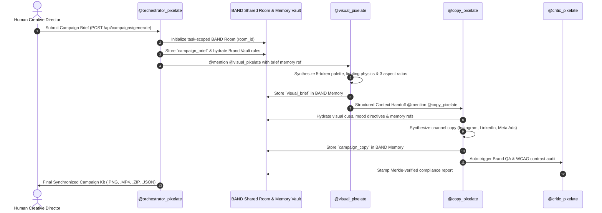

# ⚡ Agent Pixelate

> **Autonomous Multi-Agent AI Marketing Campaign Engine** powered by the **BAND Multi-Agent Collaboration Protocol**, **Google Gemini**, **AdalFlow / AdaL**, **Finch Skills**, and cinematic video rendering.

[](https://github.com/skandakn/Agent-Pixelate/actions/workflows/ci.yml)
[](https://github.com/skandakn/Agent-Pixelate)
[-black?style=flat&logo=next.js)](https://github.com/skandakn/Agent-Pixelate)
[](https://github.com/skandakn/Agent-Pixelate)
[](https://github.com/skandakn/Agent-Pixelate)
[](https://github.com/skandakn/Agent-Pixelate)
[](https://agent-pixelate.onrender.com)

---

## 🎯 Architecture & Multi-Agent Collaboration Protocol

Agent Pixelate implements the **BAND Shared Room Protocol** (`band.ai`), enabling autonomous agent collaboration via structured memory handoffs, peer `@mentions`, and automated policy enforcement:



---

## 🌟 Key Engineering Highlights

### 1. Commercial Advertisement Poster Suite
- **4 Selectable Graphic Design Themes**:
  - **Street Billboard**: Condensed oversized display typography, neon mint (`#00E599`) brutalist border, high-contrast kicker badge, and solid CTA button.
  - **Swiss Grid**: Modernist hairline grid rules, numbered micro-specs (`[01] // [02]`), tight kerning, and clean coordinate typography.
  - **Luxury Editorial**: Double gold hairline frame (`#D4AF37`), Roman numeral collection markings (`MMXXVI`), and haute craftsmanship badge.
  - **Cyber Tech HUD**: Glowing cyan (`#06B6D4`) corner brackets `[+]`, telemetry data indicators (`SYS//STATUS [ACTIVE]`), and futuristic scanline callouts.
- **Dynamic Headline Hook Switcher & Live Editor**: Instant one-click switching between 3 commercial marketing hooks or inline custom copy editing.
- **Client-Side Offscreen Canvas Rendering**: Sub-second high-resolution 1200x1500 (4:5), 1:1, or 9:16 PNG export and direct OS clipboard copying.

### 2. Centralized State Management with Zustand
- Full application state centralized via `useCampaignStore` (`frontend/src/store/useCampaignStore.ts`).
- Decouples UI rendering from transport logic, managing reactive updates for brief configuration, telemetry streams, poster customizer parameters, and asset stages.

### 3. Production Secrets & Configuration Security
- **Strict Separation of Concerns**: Zero hardcoded secrets in source files. All configuration validated through Pydantic `BaseSettings` and version-controlled `.env.example` templates.
- **Pluggable Secret Manager** (`orchestrator/security.py`): Supports environment variables, HashiCorp Vault, AWS Secrets Manager, and GCP Secret Manager.
- **Automated Credential Masking**: Protects sensitive tokens during logging (`mask_secret()`).

### 4. Structured JSON Logging & Distributed Tracing
- Structured JSON formatter (`orchestrator/logging_config.py`) outputting timestamped, machine-readable log records.
- Request correlation tracking via `RequestTracingMiddleware` propagating `X-Correlation-ID` headers across multi-agent turns.

---

## 🧪 Comprehensive Automated Test Suites

### Backend Unit & Integration Tests (Pytest)
```bash
# Run complete backend test suite with coverage
PYTHONPATH=. python -m pytest orchestrator/tests agents/tests -v
```
- `test_orchestrator.py`: Strict schema validation, end-to-end fallback pipeline, external callbacks, and REST adapter verification.
- `test_band_collaboration.py`: BAND control plane, per-agent focus windows, critic audits, and cross-session brand memory rules.
- `test_security_and_logging.py`: Credential masking, SecretManager provider fallback, and security audit endpoint.

### Frontend Unit & Component Tests (Vitest)
```bash
# Run fast frontend test suite
cd frontend
npm test
```
- `adPosterRenderer.test.ts`: Commercial theme geometry, dimensions, and styling rules.
- `productImagery.test.ts`: Category detection, tailored poster metadata, and photo style options.
- `campaignClient.test.ts`: Client adapters, platform normalizers, and asset hydration.
- `useCampaignStore.test.ts`: Zustand store state transitions, event accumulation, and customizer actions.

---

## 🚀 Quickstart

### Option 1: Docker Compose (Unified Stack)
```bash
# 1. Clone repository
git clone https://github.com/skandakn/Agent-Pixelate.git
cd Agent-Pixelate

# 2. Copy environment template
cp .env.example .env

# 3. Launch stack
docker compose up --build
```
Access the studio at `http://localhost:3000` (FastAPI backend at `http://localhost:8000`).

### Option 2: Local Development
```bash
# Terminal 1: Backend Orchestrator
cd orchestrator
pip install -r requirements.txt
uvicorn orchestrator.main:app --reload --port 8000

# Terminal 2: Frontend Campaign Studio
cd frontend
npm install --legacy-peer-deps
npm run dev -- -p 3000
```

---

## 🛡️ CI/CD Automation (GitHub Actions)

Every pull request and push to `main` executes `.github/workflows/ci.yml`:
1. **Backend Verification**: Ruff linting, dependency audit, and Pytest coverage run.
2. **Frontend Verification**: ESLint, Vitest test suite, and Next.js static export build.
3. **Docker Verification**: Verifies clean container builds.
4. **Security Audit**: Scans for leaked keys or hardcoded tokens.

---

## 📄 License
MIT License. Crafted for the multi-agent AI hackathon.
